<div align="center">


# Slab

**Free, open-source PDF tools for macOS, Windows, and Linux.**

Read, merge, split, convert, sign, and redact PDFs.
Core tools run locally; optional AI uses your configured provider.

[](https://github.com/Sanjays2402/slab/actions/workflows/build.yml)
[](LICENSE)
[](https://github.com/Sanjays2402/slab/releases/latest)

<a href="https://github.com/Sanjays2402/slab/releases/latest">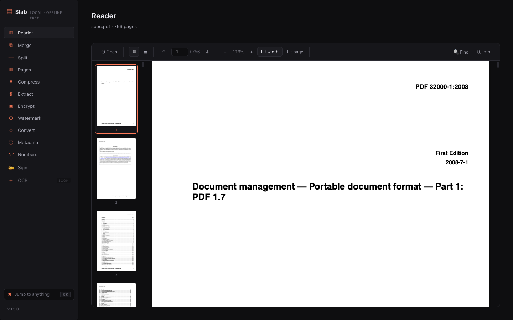</a>

**[Download Slab](https://github.com/Sanjays2402/slab/releases/latest)** ·
[Website](https://sanjays2402.github.io/slab/) ·
[Report an issue](https://github.com/Sanjays2402/slab/issues) ·
[Changelog](CHANGELOG.md) ·
[Server docs](docs/server.md) ·
[Plugins](docs/PLUGINS.md)

**A quick first run:** open a PDF, press `⌘K`, and choose Merge, Sign, or Redact. The feature tour below previews the workflow.

</div>

---

## Features

| Feature | What you can do |
|---|---|
| Merge & split | Combine PDFs, split by page ranges or chapters, or divide into balanced files. |
| Arrange pages | Reorder, rotate, delete, duplicate, or insert blank pages, with undo and redo. |
| Convert | Convert PDF content to Word, Excel, Markdown, or HTML; create PDFs from other formats. |
| OCR & extraction | Make scans searchable and extract text, images, or tables to CSV. |
| Edit & format | Edit text, crop pages, add watermarks, headers, footers, page labels, and Bates numbers. |
| Sign & redact | Place signatures, remove sensitive content, and sanitize hidden data. |
| Compare | Inspect text and visual differences between document versions. |
| Forms | Create, fill, and flatten interactive PDF forms. |
| Automate | Process watched folders with reusable recipes and batch workflows. |
| AI assistance | Ask questions, find citations, create summaries, flashcards, and glossaries. |
| Create & present | Turn Markdown into PDFs and present PDFs as slides or in a focused reader. |
| CLI & server | Script PDF tasks from the command line or run a self-hosted HTTP API. |
| Appearance | Choose Light, Dark, OLED, White, or Glass, with nine accent colors. |

OCR requires Poppler and Tesseract. AI uses your configured local or cloud provider.

## Why Slab

| | |
|---|---|
| 🔒 **Local-first** | Core PDF tools run on your device. AI can also run locally with Ollama; cloud processing depends on the provider you configure. |
| ⚡ **Fast** | Native Rust core. A hundred-file merge finishes before your coffee does. |
| 🪶 **Tiny** | ~15–25 MB installers. No Electron bloat. |
| 💸 **Honest** | Free forever, GPL-3.0. No accounts, no telemetry, no "Pro" tier. |

## Take the tour

**Beacon — AI with your choice of provider.** Chat with citations, semantic search across your library, one-click PII redaction, summaries, study flashcards, glossary, and voice. Use Ollama for on-device AI, or configure an OpenAI-compatible endpoint.

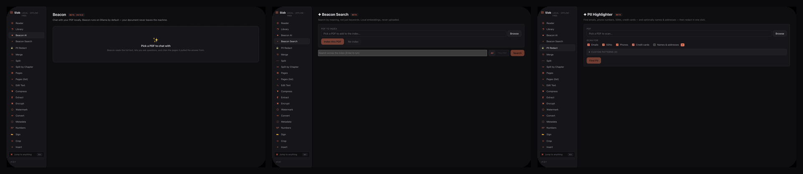

**The everyday craft.** Merge a hundred files in a second. Drop a signature or an `APPROVED` stamp on any page. Burn redactions into the content stream. OCR a scanned stack into searchable text.

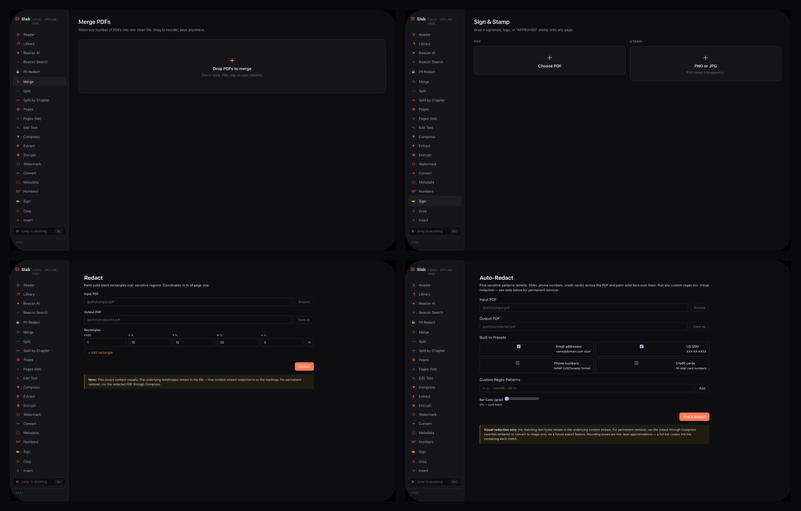

**Find anything, instantly.** A browsable library across every PDF you've imported, line-level diff between any two documents, and one `⌘K` palette to reach all 65 tools.

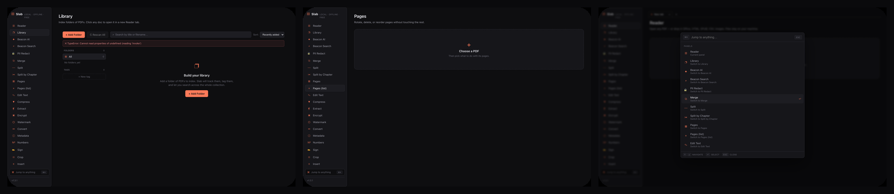

## OLED theme — true black

A fifth appearance option for emissive displays: true-black `#000000` surfaces, so pixels switch off instead of glowing dark grey. Pick it in Settings, or press `⌘K` and type "theme".

| | |
|---|---|
| 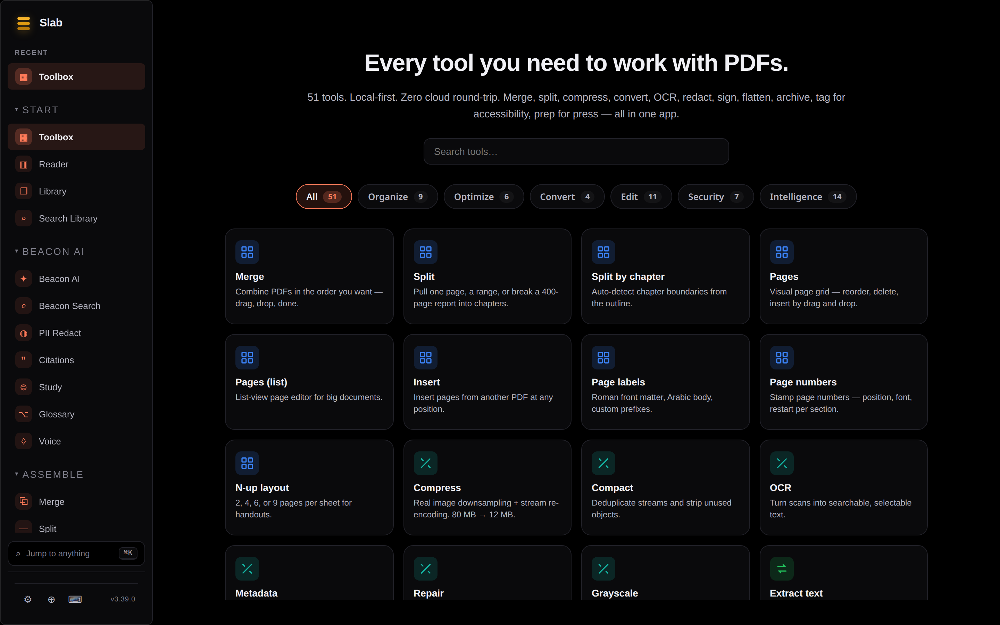 | 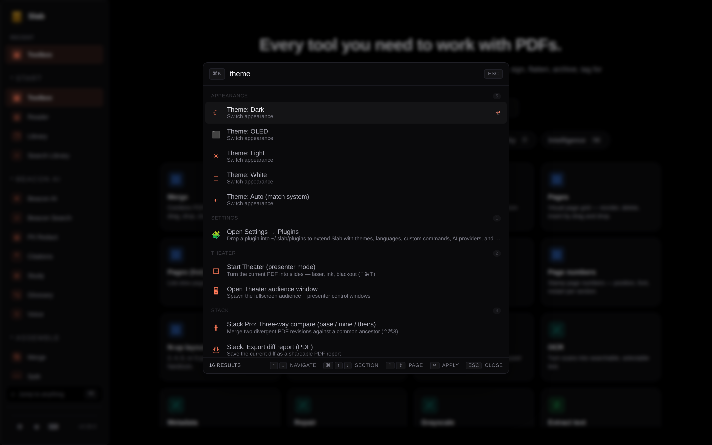 |
| 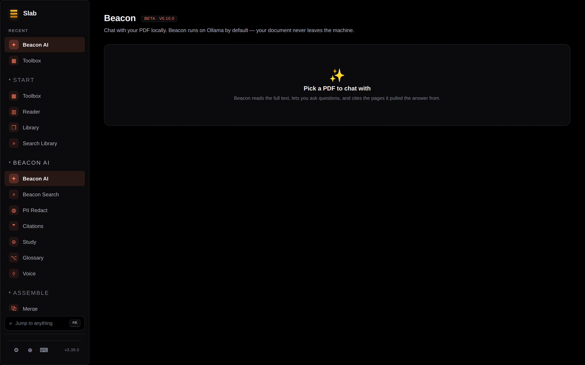 | 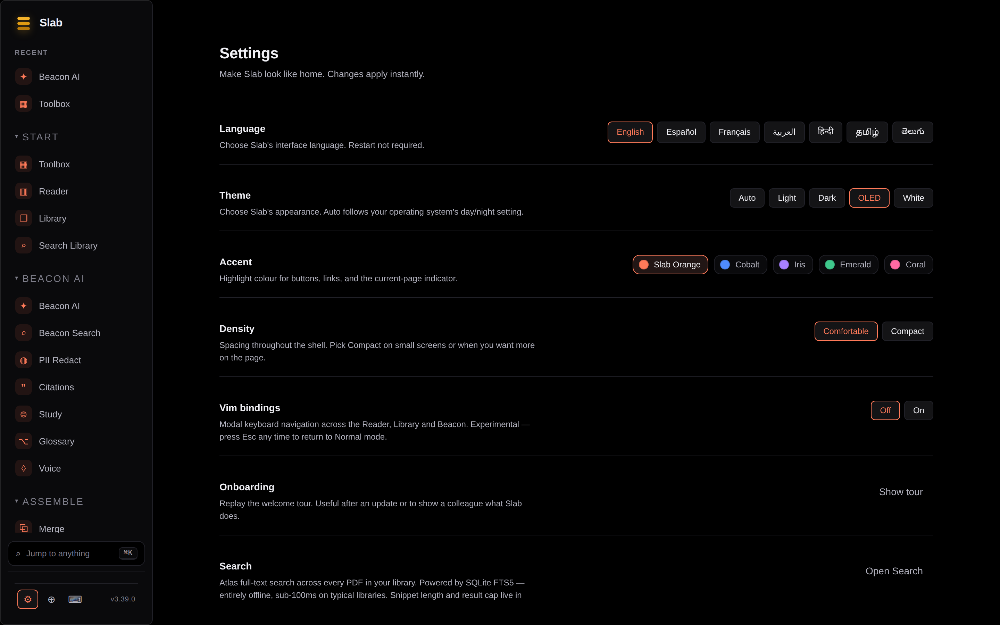 |

## Glass theme — make it yours

Translucent panels over a softly tinted background, with nine accent colors: Orange, Cobalt, Iris, Emerald, Coral, Teal, Amber, Lime, and Slate. Choose Glass and your accent in Settings.

These screenshots show the current `main` branch. The Glass theme and PDF workflow polish will ship in the next release.

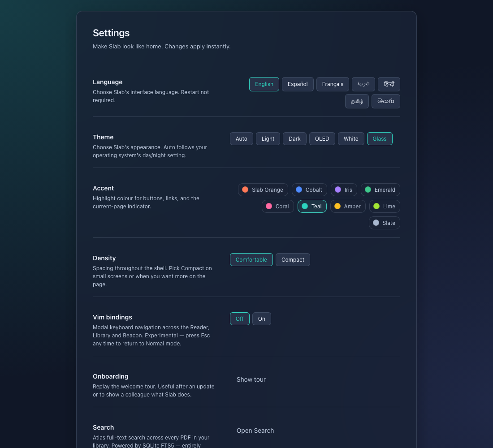

<details>
<summary><strong>More PDF workflow screenshots</strong> — Split previews and Merge results</summary>

The compact panels keep page ranges, output filenames, and saved-file actions easy to reach.

| Split — preview every output | Merge — arrange and save |
|---|---|
| 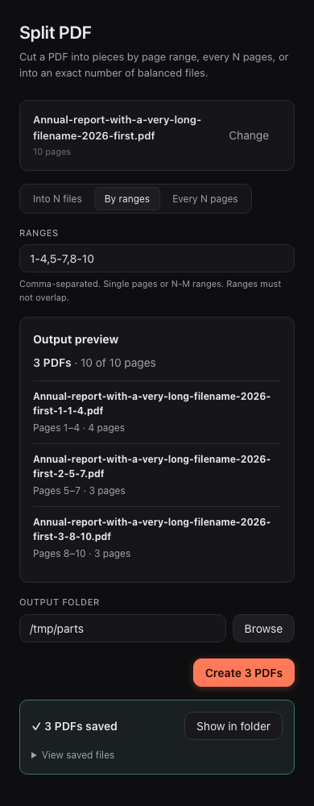 | 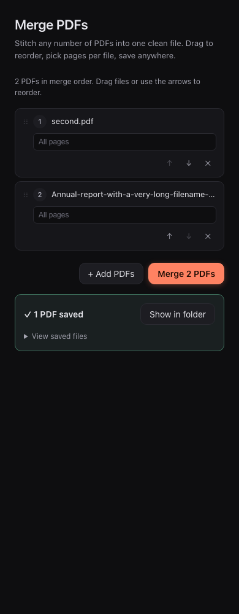 |

</details>

## Hopper — folders that file themselves

Point Hopper at a folder — `~/Downloads`, a scanner, a shared inbox — and attach a recipe. New PDFs get flattened, OCR'd, redacted, watermarked, renamed by Beacon, and filed away, with a live log streaming every run.

Six predicate kinds route each file (filename, regex, text contents, page count, size, catch-all), and a live preview pane shows what each rule would catch against your *actual* recent files. `⇧⌘H` to open it.

Hazel charges $42 and can't read PDFs. Adobe's automation needs an enterprise license and phones home. Hopper is free and local.

## Slab Server — the same engine, in 80 megabytes

Headless Slab: an HTTP API plus a drag-and-drop web UI in a single Docker image. Put it on your NAS, script it, hide it behind a reverse proxy.

```bash
docker run --rm -p 8080:8080 ghcr.io/sanjays2402/slab:latest
```

Open [http://localhost:8080](http://localhost:8080), drop a PDF on the page.

The server is open by default. To require a key on every API call, set `SLAB_API_KEY` and send it as `Authorization: Bearer <key>` or `X-Api-Key: <key>`; use `SLAB_BIND=127.0.0.1:8080` to listen on localhost only.

```bash
docker run --rm -p 8080:8080 -e SLAB_API_KEY=change-me ghcr.io/sanjays2402/slab:latest
```

Full API, configuration and Compose example: [docs/server.md](docs/server.md).

## 65 tools, one palette

<details>
<summary><strong>See every tool</strong> — press <kbd>⌘K</kbd> anywhere in the app to jump to any of them</summary>

| Group | Tools |
|---|---|
| Read & organize | Reader · Library · Search Library · Pages · Pages (list) · Slides · Theater |
| Assemble | Merge · Split (balanced N files, live preview, overlap validation) · Split by Chapter · Insert · N-up · Flatten · Bind (PDF → EPUB) |
| Convert | PDF → Images · Convert · Reflow (PDF → Word) · Tabulate (PDF → Excel) · Markdown (PDF → MD/HTML) · Markdown → PDF · Compress · Compact · Streamline (Fast Web View) · Archive (PDF/A) · Press (PDF/X-4) · Grayscale |
| Edit | Remove Blank Pages · Edit Text · Crop · Watermark · Header/Footer · Page Labels · Numbers · Bates · Legal Stamp · Metadata |
| Protect | Encrypt · Redact · Auto-Redact · Veil · Sanitize · Sign · Signet · Batch Sign |
| Analyze | OCR · Extract · Tables → CSV · Diff · Compare · Compare 3-way · Repair |
| Beacon AI | Beacon AI · Beacon Search · PII Redact · Citations · Study · Glossary · Voice |
| Automate | Hopper (Watched Folders) · Atelier (Recipes) · Quill Batch · Quill Designer · Quill Auto-Detect |
| Create | Forms · Toolbox · Loom (PDF/UA) · Loupe (PDF/A check) |

</details>

## Also in the box

- **Standalone CLI** — a separate `slab` binary ships in every bundle: `slab autoredact in.pdf out.pdf --preset email,ssn`, no GUI needed.
- **Polyglot** — point Slab at `.docx` `.xlsx` `.pptx` `.epub` `.csv` `.json` `.html` `.rtf` `.odt`, images (EXIF + OCR text), even audio (EXIF + transcription) and get PDFs out.
- **Detachable panels** — pop any panel into its own window. Beacon on the second monitor, two Readers side by side.
- **Vim mode** — modal keybindings (`gg`/`G`/`j`/`k`, counts, `/` search, `:42`) in Reader, Library, and Beacon.
- **A11y & i18n** — built-in accessibility audit, full keyboard control, and a JSON locale system.

## Install

Pre-built installers ship with every [release](https://github.com/Sanjays2402/slab/releases):

| Platform | Files |
|---|---|
| macOS (Apple Silicon + Intel) | `.dmg` |
| Windows | `.msi` + `.exe` |
| Linux | `.deb` + `.AppImage` + `.rpm` |

**First launch on macOS:** the builds are ad-hoc signed (no $99/year Apple Developer ID yet), so Gatekeeper warns once. Right-click **Slab.app** → **Open** → **Open** in the dialog. Every launch after is a normal double-click. Verify the signature yourself with `codesign -dvv /Applications/Slab.app`. To help fund a Developer ID so this prompt goes away for everyone, see [SIGNING.md](SIGNING.md).

## Build from source

Prereqs: Rust stable, Node ≥ 22.12, pnpm ≥ 9, plus the [Tauri system dependencies](https://tauri.app/start/prerequisites/) for your platform (WebView2 and the MSVC build tools on Windows; `webkit2gtk` and friends on Linux).

```bash
git clone https://github.com/Sanjays2402/slab
cd slab
pnpm install
pnpm tauri dev          # run in dev mode
pnpm tauri build        # installer / app bundle for your platform
```

Optional runtime deps for the AI side: [Ollama](https://ollama.com) + `ollama pull llama3.2:3b` for Beacon chat; `whisper-cpp` for voice dictation. The settings panel tells you exactly what's missing.

### Tests

```sh
pnpm check
pnpm test               # TypeScript, split planning, browser PDF helpers, i18n
pnpm exec playwright install chromium
pnpm test:e2e           # navigation and PDF workflows in Chromium
pnpm test:website       # published website, mobile, policies and screenshots
cargo test --locked --lib --bins --features server --manifest-path src-tauri/Cargo.toml
cargo build --locked --features server --bin slab --bin slab-server --manifest-path src-tauri/Cargo.toml
pnpm test:native        # actual CLI and HTTP API PDF round-trips
```

`test:e2e` starts Vite automatically. Native tests generate their own PDFs, use a temporary output folder and start the server on a local ephemeral port. Set `SLAB_CLI` / `SLAB_SERVER` for binaries in another location, `SLAB_SITE_URL` for another website deployment, or `SLAB_CHROMIUM_PATH` for an installed Chromium executable. Native dialog interactions in browser tests use a test bridge; `test:native` exercises the real Rust commands and HTTP server. OCR integrations need Poppler and Tesseract; AI integrations need configured providers.

## Extend Slab

- **Plugins and themes** — write your own with the [plugin guide](docs/PLUGINS.md) and the [`slab-plugin-sdk`](sdk/slab-plugin-sdk); working samples live in [`examples/plugins`](examples/plugins).
- **Marketplace** — how listings are structured and submitted: [docs/MARKETPLACE.md](docs/MARKETPLACE.md).

## Contributing

Bug reports and pull requests are welcome. Before opening a PR, run `pnpm check` and `pnpm test` (see [Tests](#tests)); Rust changes should also pass `cargo fmt` and `cargo clippy`. Report security issues privately as described in [SECURITY.md](SECURITY.md).

## Under the hood

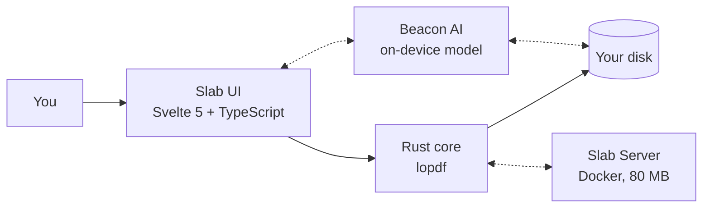

Tauri 2 shell, Svelte 5 front-end, pure-Rust PDF core (`lopdf`), `pdfjs-dist` rendering, Tesseract OCR, local embeddings + on-device chat for Beacon. 730+ Rust tests, clippy-clean, cross-platform CI.

## A small promise

Slab will never ask for an email. Will never call home on its own (the optional update check only runs when you click it or opt in, and sends nothing about you). Will never gate a feature behind a paywall. If it ever does any of those things, you have my permission to fork it and rip the offending lines out.

Made with 🍰 by [@Sanjays2402](https://github.com/Sanjays2402).

## Terms & Disclaimer

By using this project you agree to the following.

- **No warranty.** This software is provided "as is", without warranty of any kind, express or implied, including merchantability, fitness for a particular purpose, and non-infringement.
- **No liability.** To the maximum extent permitted by law, the author and contributors are not liable for any claim, loss, or damage (direct, indirect, incidental, or consequential, including lost data or profits) arising from its use.
- **Your responsibility.** You use it at your own risk and are responsible for complying with the laws that apply to you.
- Redaction, signature, and standards-check (PDF/A, PDF/X, PDF/UA) results are not guaranteed and are not legal or compliance advice; always check the output.
- **Third parties.** Names, logos, APIs, and services of others belong to their owners and are used for identification only; no affiliation or endorsement is implied.
- **Your statutory rights.** Nothing here limits rights that cannot be waived by agreement, including under consumer-protection laws in the USA, Canada (including Quebec), and India (Consumer Protection Act, 2019).
- **License.** Use, copying, and distribution are governed by the [LICENSE](LICENSE) file; if anything here conflicts with it, the license controls.

## Content, Assets & Fair Use

- **Original work.** Unless noted otherwise (including below), the code, text, design, and images in this repository were created by the author.
- **Libraries, fonts, and icons.** Third-party libraries, fonts (for example Google Fonts), and icon sets belong to their creators and are used under their own licenses; see the dependency manifests and each source for terms.
- **Logos, brands, and screenshots.** Third-party names, logos, and screenshots appear only to identify or describe their products (nominative use). They remain the property of their owners and do not imply affiliation or endorsement.
- **Ideas and inspiration.** Where this project is inspired by another product, game, or idea, it is an independent implementation. It borrows only general ideas, mechanics, or styles, which are not anyone's exclusive property, and is meant to contain no third-party code or artwork used without permission.
- **Fair use and fair dealing.** Any third-party material is used in limited ways for purposes such as education, research, review, commentary, or identification, relying on fair use in the USA (17 U.S.C. § 107), fair dealing in Canada (Copyright Act, ss. 29–29.2), and fair dealing in India (Copyright Act, 1957, s. 52), where they apply.
- **Concerns and takedown requests.** If you own rights in something here and believe it is used improperly, [open an issue](https://github.com/Sanjays2402/slab/issues) or contact the author through their GitHub profile with a link to the material and your claim. It will be reviewed promptly and credited, changed, or removed as appropriate. You may also use GitHub's DMCA process.
- **Contributions.** By contributing, you confirm you have the right to submit your contribution and agree it is licensed under this repository's license.
- **Website.** The project site has its own [Terms](https://sanjays2402.github.io/slab/terms.html) and [Fair Use](https://sanjays2402.github.io/slab/fair-use.html) pages.
